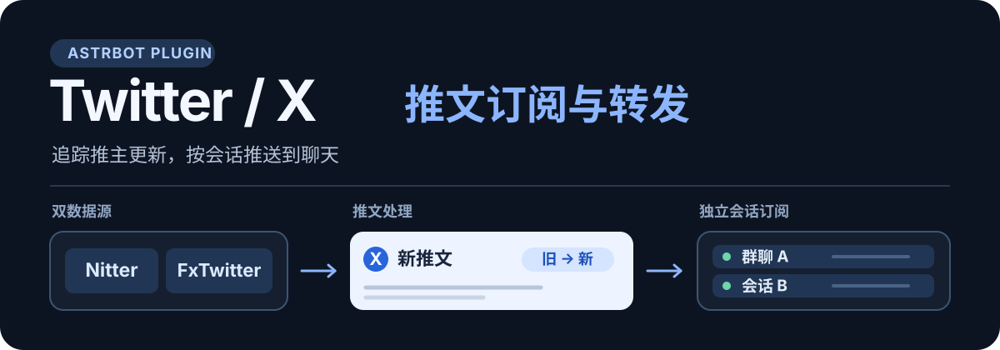
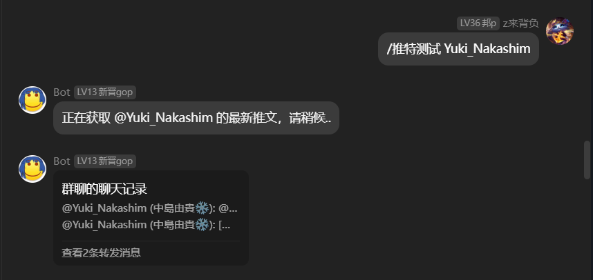
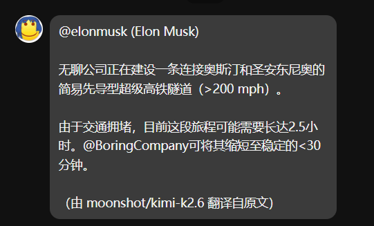
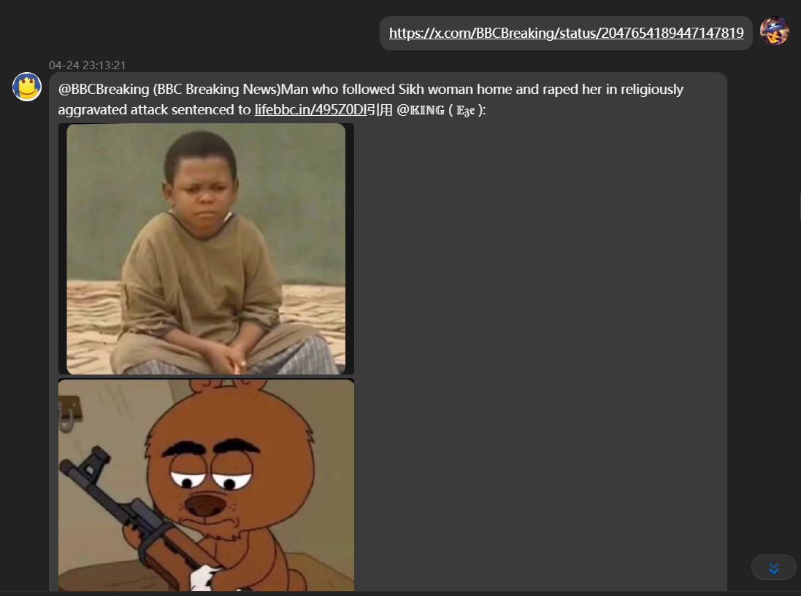
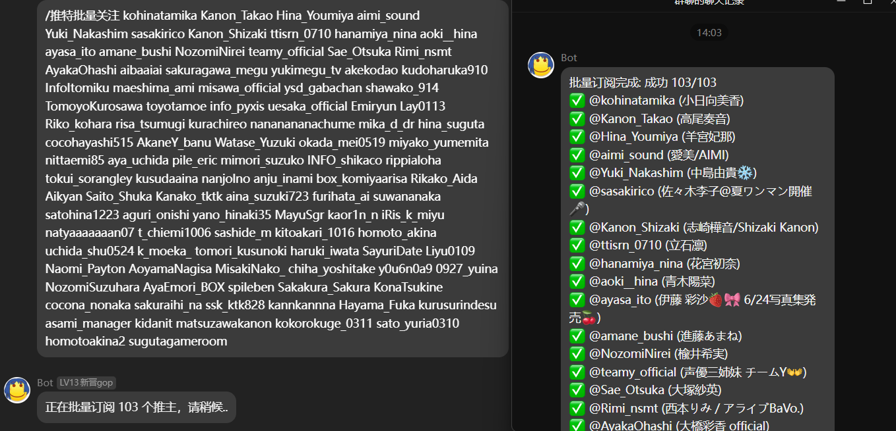
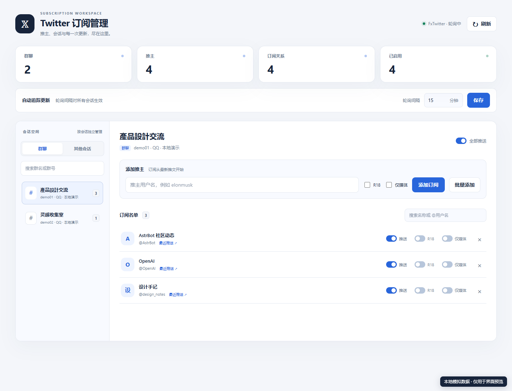

# Twitter 推文转发

自动推送关注的 X/Twitter 推文，支持 QQ、Telegram、链接解析、翻译、截图及 WebUI 订阅管理。



## 效果展示

推文可按普通消息或合并转发发送；截图模式可将正文渲染成仿推特风格的时间线卡片。

<p align="center"><strong>合并转发推送</strong><br></p>

<p align="center"><strong>截图模式 · 仿推特风格渲染</strong><br><a href="./asset/readme/tweet-screenshot-render.png"></a></p>

<details>
<summary>展开查看翻译、链接识别与批量关注效果</summary>

**推文翻译**



**链接识别**



**批量关注**



</details>

## 快速开始

1. 将本仓库放入 AstrBot 的插件目录，进入该目录后，在 AstrBot 使用的 Python 环境中安装依赖：

   ```bash
   pip install -r requirements.txt
   ```
2. 在 AstrBot 中加载插件，选择可用的数据源：默认使用 Nitter，需填写可用的 `twitter_nitter_url`；使用 FxTwitter 时，将 `twitter_data_provider` 改为 `fxtwitter`，并配置可用的 `twitter_fxtwitter_api_base`。保存后重载插件。
3. 在要接收推送的会话中发送 `/推特关注 <用户名>`，然后用 `/推特测试 <用户名>` 检查消息效果；发送 `/推特列表` 可查看当前会话的订阅。

首次将新推主加入插件时，默认从当前最新内容开始跟踪，之后自动推送新帖；需要立即查看一条推文时可使用 `/推特测试`。

正文发送失败会自动重试，已完成的会话会跳过，无需重新关注。积压较多时，按“每个推主每轮最多推送推文数”分轮发送。

## 主要功能

- **按会话订阅**：群聊、私聊各自维护订阅与推送开关；支持指令和 WebUI 管理。
- **定时追踪**：从 Nitter 或 FxTwitter 读取增量推文，按旧到新推送；每个推主每轮可限制推送数量。
- **失败补发**：正文发送失败后自动重试，只向未完成的会话补发。
- **消息呈现**：支持普通消息、单条或集体合并转发、深浅色截图、图片与视频，以及可选的转帖去重。
- **按需解析与翻译**：手动或自动解析 `twitter.com` / `x.com` 链接；可选择 X 自带翻译（仅 FxTwitter）或 LLM 翻译。
- **Agent 推送摘要**：开启后，可向 AI 询问本会话最近成功推送的内容。

### WebUI 订阅管理

在支持 **Plugin Pages API** 的 AstrBot 版本中，可从 Dashboard 打开“Twitter 订阅管理”。页面提供会话搜索、订阅开关、R18 与仅媒体设置、群级推送开关和轮询间隔调整。

下图使用**模拟数据**展示 WebUI，不是真实群聊或推送记录。



选中已连接的群聊后，可单个或批量添加推主。批量输入支持换行、空格、逗号与分号分隔，每批最多 100 个不同的有效账号；执行时可停止后续请求，已成功的添加不会撤销。点开某位推主可查看该会话最近 **5 条成功推送**的文字摘要、时间与原帖链接；记录保存在订阅数据中，插件重载后仍可查看，不保存媒体文件。旧订阅在此功能上线前的推送不会补录。

旧版 AstrBot 若缺少 Plugin Pages API，插件主体仍可加载，订阅可继续通过聊天指令管理。

群详情右上角的“清空订阅”可一次取消本群的全部订阅，确认后生效，不影响其他群和私聊；群聊本身不会被删除。

订阅名单旁的“复制列表”可复制当前会话的全部推主 ID，以空格分隔（如 `AstrBot OpenAI`），可直接粘贴用于批量关注。搜索筛选不影响复制范围。

### Telegram

支持 AstrBot 官方 `telegram` 适配器，可在私聊、群聊和超级群话题中使用订阅、定时推送、链接解析、翻译、截图及媒体发送。先按照 [AstrBot Telegram 接入文档](https://docs.astrbot.app/platform/telegram.html) 配置机器人；群聊需要接收普通链接时，按文档关闭 BotFather 的 Privacy mode，并确认机器人有发言与媒体发送权限。

Telegram 按帖子发送图片相册，链接附于说明，长正文和视频单独发送；无需关闭 QQ 的合并转发设置。开启集体转发后，Telegram 会在轮询结束时逐帖发送。

Telegram 无法自动列出机器人加入的全部群聊。可在 WebUI 点击“添加 Telegram 群组”，选择机器人并填写完整负数群 ID。机器人需在群内且有发言权限。手动添加的群组即使暂无订阅或重载插件也会保留；机器人退群或暂时无法连接时，群组仍会显示，但暂不能新增订阅。

手动添加的群组清空全部订阅后，可在群详情右上角点击“删除群组”，确认后从列表移除。此操作仅删除列表记录；机器人离线、退群或平台实例已移除时，也可删除空的手动群组记录。有订阅的群组需先移除全部订阅。

也可在目标聊天内通过指令建立订阅。话题需在对应话题中首次执行订阅指令，之后在 WebUI 管理；私聊订阅在“其他会话”中管理，新增仍使用聊天指令。

#### Telegram 视频发送限制

公共 Bot API 的视频上传上限为 **50 MB**，插件默认与之对齐。发送更大视频需自建并启用 `--local` 的 Bot API 服务（最高 2000 MB），再提高插件的 Telegram 视频上限。

AstrBot v4.29.4 的 Telegram 适配器默认上传写入超时为 **20 秒**，插件无法通过视频大小设置调整它。这是网络写入等待的超时，不是整个视频上传的总时限；网络不稳定或上传阻塞时，未达到文件大小上限的视频也可能发送失败。

频繁失败时，可降低视频直发上限，或使用同机、同内网的自建 Bot API 服务。超限或发送失败的视频会改发说明与链接，不影响已发送的正文。

## 聊天指令

指令作用于**当前会话**，除非下表另有说明。`<用户名>` 可填写推主 ID，关注时也可带 `@`。

QQ 群内成员共享订阅、推送开关和推送摘要，不受 AstrBot「按成员隔离会话」设置影响。旧的成员订阅会自动合并为群订阅，无需重新关注。

| 指令                                               | 英文别名                    | 作用                                        |
| -------------------------------------------------- | --------------------------- | ------------------------------------------- |
| `/推特关注 <用户名> [r18] [媒体]`                | `/twitter_follow`         | 关注推主；可选允许 R18、仅推送含媒体的内容  |
| `/推特批量关注 <用户1> <用户2> ... [r18] [媒体]` | `/twitter_batch_follow`   | 批量关注，选项应用于本次所有推主            |
| `/推特取关 <用户名>`                             | `/twitter_unfollow`       | 取消当前会话中的订阅                        |
| `/推特批量取关 <用户1> <用户2> ...`              | `/twitter_batch_unfollow` | 批量取消当前会话中的订阅                    |
| `/推特列表`                                      | `/twitter_list`           | 查看当前群聊或私聊关注的推主                |
| `/推特推送 <开启\|关闭>`                          | `/twitter_push`           | 开关当前会话的全部推送                      |
| `/推特测试 <用户名>`                             | `/twitter_test`           | 立即获取并发送该推主的最新推文              |
| `/推特解析 <推文链接>`                           | `/twitter_parse`          | 手动解析指定推文链接                        |
| `/推特清空订阅`                                  | `/twitter_clear_all`      | 清空所有会话的订阅；需要 AstrBot 管理员权限 |

`/推特列表` 在 QQ 中显示为合并转发卡片，在 Telegram 中直接显示为文字；列表较长时自动分段。

## 配置参考

在 AstrBot 插件配置页面设置以下选项，下表列出默认值。

| 常用配置                             | 默认值                        | 用途                                         |
| ------------------------------------ | ----------------------------- | -------------------------------------------- |
| `twitter_data_provider`            | `nitter`                    | 选择 `nitter` 或 `fxtwitter`             |
| `twitter_nitter_url`               | 空                            | 自定义 Nitter 镜像地址；只在 Nitter 模式使用 |
| `twitter_fxtwitter_api_base`       | `https://api.fxtwitter.com` | FxTwitter API 地址；只在 FxTwitter 模式使用  |
| `twitter_poll_interval`            | `5`                         | 轮询间隔，单位为分钟                         |
| `twitter_poll_max_tweets_per_user` | `5`                         | 每位推主每轮最多推送的条数                   |
| `twitter_text_render_mode`         | `text`                      | `text` 文字，或 `screenshot` 截图        |
| `twitter_translate_enabled`        | `false`                     | 是否翻译推文正文                             |

<details>
<summary>展开查看全部配置项</summary>

### 数据源与网络

| 配置项                               | 默认值                        | 说明                                                                        |
| ------------------------------------ | ----------------------------- | --------------------------------------------------------------------------- |
| `twitter_data_provider`            | `nitter`                    | `nitter` 抓取 HTML；`fxtwitter` 读取 JSON API                           |
| `twitter_nitter_url`               | 空                            | 自定义 Nitter 镜像地址                                                      |
| `twitter_fxtwitter_api_base`       | `https://api.fxtwitter.com` | FxTwitter API 基础地址                                                      |
| `twitter_proxy`                    | 空                            | 可选代理，例如 `http://127.0.0.1:7890`                                    |
| `twitter_pre_download_media`       | `false`                     | 配置代理后预下载图片与视频封面；失败时回退原 URL                            |
| `twitter_poll_interval`            | `5`                         | 轮询间隔（分钟），建议不低于 3                                              |
| `twitter_poll_max_tweets_per_user` | `5`                         | 每位推主每轮最多推送条数，实际范围为 1–500                                 |
| `twitter_detailed_diagnostics`     | `false`                     | 详细诊断日志；开启后配合 AstrBot DEBUG 级别查看逐请求、逐页、逐图和上传过程 |

### 消息格式

| 配置项                                 | 默认值    | 说明                                                                                                                                             |
| -------------------------------------- | --------- | ------------------------------------------------------------------------------------------------------------------------------------------------ |
| `twitter_use_node`                   | `true`  | QQ 使用合并转发；Telegram 按帖子发送相册或单张照片，长正文和视频单独发送                                                                         |
| `twitter_no_text`                    | `false` | 推文含媒体时不输出文字                                                                                                                           |
| `twitter_text_render_mode`           | `text`  | `text` 文字，或 `screenshot` 截图                                                                                                            |
| `twitter_screenshot_theme`           | `dark`  | 截图使用 `dark` 或 `light` 主题                                                                                                              |
| `twitter_send_media_separately`      | `true`  | 正文或截图之外继续发送原图、视频及视频降级链接                                                                                                   |
| `twitter_image_quality`              | `orig`  | `large` 缩略图，或 `orig` 原图                                                                                                               |
| `twitter_video_max_size_mb`          | `256`   | QQ 等非 Telegram 平台的视频直发大小上限（MB），超过后发送链接                                                                                    |
| `twitter_telegram_video_max_size_mb` | `50`    | 视频超限时改发链接。公共 API 上限 50 MB；更大文件需自建 `--local` Bot API（最高 2000 MB）。详见 [Telegram 视频发送限制](#telegram-视频发送限制) |
| `twitter_collective_forward`         | `false` | 将一轮轮询的多条推文汇总为合并转发；需同时开启 `twitter_use_node`                                                                              |
| `twitter_collective_max_authors`     | `5`     | 单条集体转发消息中的最多推主数                                                                                                                   |
| `twitter_include_tweet_link`         | `true`  | 在推送、测试和解析消息末尾附带帖子链接                                                                                                           |

Telegram 视频上限独立于 QQ，对引用帖、测试和链接解析同样生效，不影响照片限制。大小无法探测时仍尝试发送，更多说明见 [Telegram 视频发送限制](#telegram-视频发送限制)。

### 内容与翻译

| 配置项                                      | 默认值       | 说明                                                               |
| ------------------------------------------- | ------------ | ------------------------------------------------------------------ |
| `twitter_include_retweets`                | `true`     | 轮询与测试时包含转帖                                               |
| `twitter_deduplicate_retweets`            | `false`    | 同一原帖被多个推主转发时按会话去重                                 |
| `twitter_link_recognition_enabled`        | `auto`     | `auto` 自动解析、`command` 仅指令解析、`off` 关闭            |
| `twitter_agent_query_enabled`             | `false`    | 允许 Agent 调用 `twitter_recent_pushes` 查询本会话推送摘要       |
| `twitter_translate_enabled`               | `false`    | 自动翻译推文正文                                                   |
| `twitter_translate_method`                | `llm`      | `x` 使用 X 自带翻译，`llm` 使用 LLM 翻译；旧配置默认使用 LLM   |
| `twitter_translate_native_lang`           | `zh`       | X 翻译目标语言代码，如 `zh`、`ja`、`en`；仅选择 X 翻译时显示 |
| `twitter_translate_target_lang`           | `简体中文` | LLM 翻译目标语言；仅选择 LLM 翻译时显示                            |
| `twitter_translate_provider_id`           | 空           | 仅选择 LLM 翻译时显示；留空时依次尝试当前会话与第一个可用 Provider |
| `twitter_translate_timeout_seconds`       | `60`       | 单条推文翻译的总时限（秒），超时回退原文                           |
| `twitter_translate_custom_prompt_enabled` | `false`    | 使用自定义翻译 system prompt；仅选择 LLM 翻译时显示                |
| `twitter_translate_custom_prompt`         | 内置提示词   | 自定义提示词，支持 `{target_lang}` 变量；仅选择 LLM 翻译时显示   |

**翻译方式说明**：X 自带翻译仅支持 FxTwitter 数据源；使用 Nitter 时选择此方式不翻译。接口未返回译文或翻译失败时保留原文，不自动调用 LLM。上游不支持 **X Article 长文章正文翻译**，文章正文仍显示原文；如需翻译文章，请选择 LLM 翻译并配置可用的 Provider。

</details>

## 使用前了解

- **Nitter 镜像**：nitter镜像站目前已不可用 2026/8/27；需要自行部署时可参考 [Nitter 项目](https://github.com/zedeus/nitter)及[本地部署教程](https://mib7kzqsrf5.feishu.cn/wiki/O1ztwWl3GiBc4AknKvIcyaKsnFb?from=from_copylink)。
- **FxTwitter 数据**：FxTwitter 是第三方公开 JSON API，并非 X/Twitter 官方 API；接口、限流和可用性由其服务决定。也可参考 [FxTwitter 官方仓库（FxEmbed）](https://github.com/FxEmbed/FxEmbed) 自行部署，并将 `twitter_fxtwitter_api_base` 设置为自建实例的 API 地址。
- **历史补发范围**：已获取但未完成推送的帖子会继续尝试；停机过久、帖子被删除或数据源不再提供时，无法保证补齐全部历史。
- **重复发送**：发送后进程异常退出或保存进度失败，恢复后可能重复发送少量内容。
- **会话隔离**：私聊和群聊分别保存订阅；在一处取关或关闭推送，不影响其他会话。
- **截图头像缓存**：截图模式会在本地缓存头像，缓存有容量限制，不保存推文原图或视频。

## 遇到问题时

正文推送失败时先等待下一轮自动重试；视频频繁变成链接时，可先降低 Telegram 视频直发上限，并检查网络连接。插件的代理设置不会自动应用于 Telegram 发送。

需要提交问题时：

1. 在插件基础设置中开启“详细诊断日志”，将 AstrBot 日志级别设为 DEBUG，保存并重载插件。
2. 重现一次问题，记录发生时间和执行的指令。
3. 提交问题描述、AstrBot 与插件版本，以及对应时段的日志。
4. 排查结束后关闭详细诊断日志。

日志字段和进度说明见[诊断日志参考](./docs/diagnostics.md)。

## 参考与反馈

本插件参考了 [nonebot-plugin-twitter](https://github.com/nek0us/nonebot-plugin-twitter) 的 Nitter 抓取思路、[astrbot_plugin_rsshub](https://github.com/FlanChanXwO/astrbot_plugin_rsshub) 的订阅管理与 KV 存储模式，以及 [astrbot_plugin_qq_group_daily_analysis](https://github.com/SXP-Simon/astrbot_plugin_qq_group_daily_analysis) 的 LLM Provider 选择思路。

项目代码由 Codex 辅助生成与迭代。遇到问题欢迎提交 [Issue](https://github.com/Ars1027/astrbot_plugin_twitter/issues)，也欢迎提交 Pull Request。代码采用 [MIT License](./LICENSE)。
